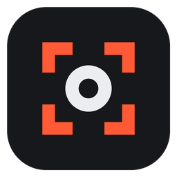
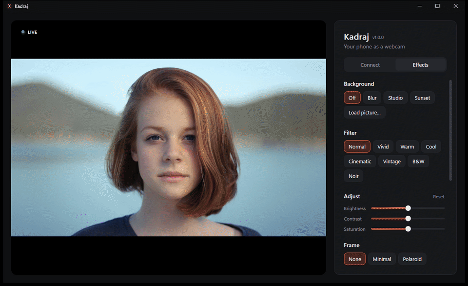
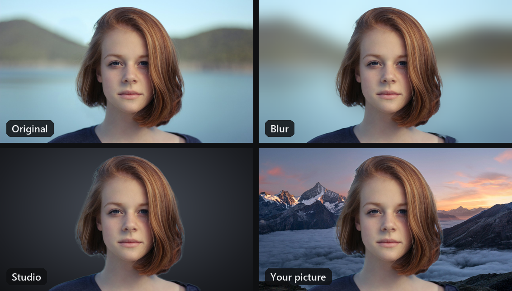
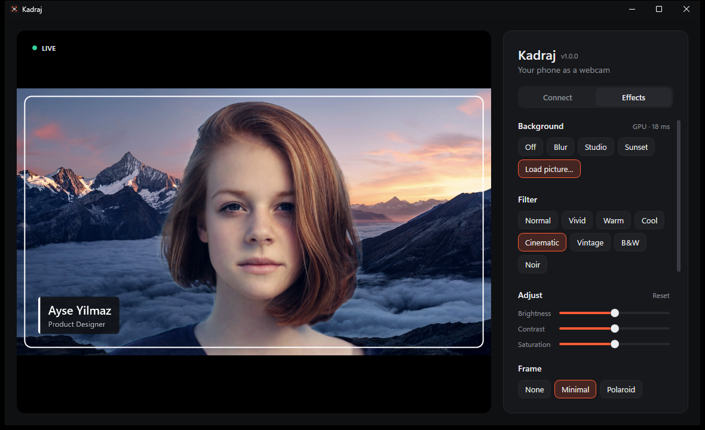
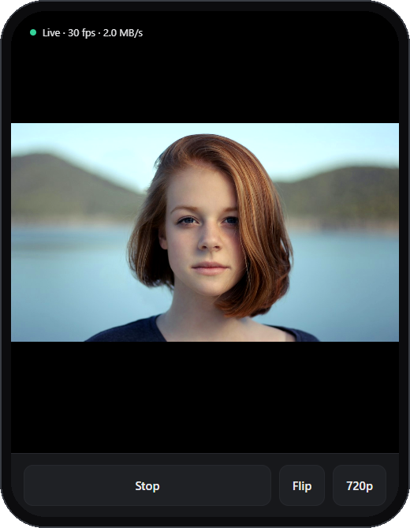
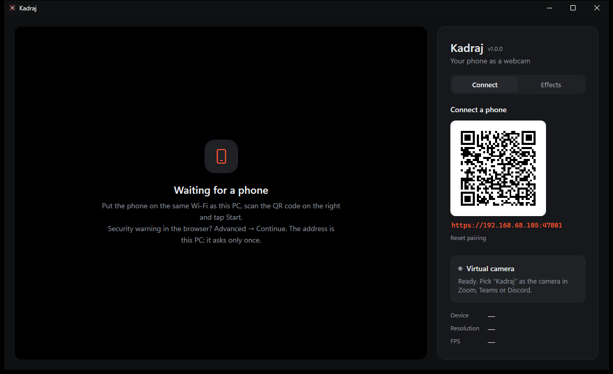
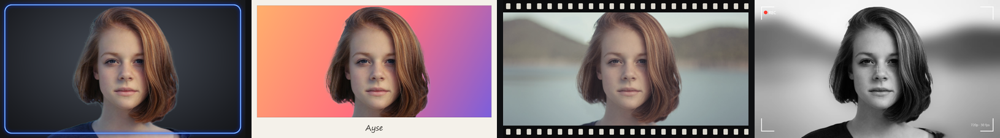
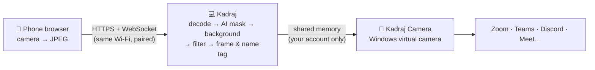

<p align="center">
  
</p>

<h1 align="center">Kadraj</h1>

<p align="center">
  <b>Turn your phone into a webcam for Windows, with AI backgrounds, filters, frames and a name tag.</b><br>
  Nothing to install on the phone. Scan a QR code and you're live in Zoom, Teams, Discord or Meet.
</p>

<p align="center">
  <a href="https://github.com/Cafu1107/kadraj/releases/latest/download/Kadraj-win-x64.zip"></a>
  &nbsp;
  <a href="https://cafu1107.github.io/kadraj/"></a>
</p>

<p align="center">
  <a href="https://github.com/Cafu1107/kadraj/actions/workflows/ci.yml"></a>
  <a href="https://github.com/Cafu1107/kadraj/releases/latest"></a>
  <a href="LICENSE"></a>
  
  
</p>

<p align="center"><b>English</b> · <a href="README.tr.md">Türkçe</a></p>

<p align="center">
  
</p>

## Why Kadraj?

Your phone's camera is much better than the one in your laptop. Kadraj lets you use it as your PC's webcam, and it adds the extras video calls actually need:

- **A real camera for every app.** Kadraj shows up as **"Kadraj"** in the camera list of Zoom, Teams, Discord, browsers and any other app that uses a webcam. Your effects go with it.
- **No phone app.** The phone opens a page in its browser. Scan the QR code, tap **Start**.
- **AI backgrounds that hold up.** Headsets, hands and waving arms stay in the picture, and the edges don't flicker.

## Features

| 📱 Connect | 🧠 Background | 🎨 Look |
|---|---|---|
| Same Wi-Fi, scan a QR code, done | **Blur**, **Studio**, **Sunset** or **your own picture** | 8 filters: Vivid, Warm, Cool, Cinematic, Vintage, B&W, Noir… |
| Front / back camera, 720p or 1080p | Robust Video Matting on your GPU, about 15 ms per frame | Brightness, contrast and saturation sliders |
| Flashlight button on phones that have one | Falls back to the CPU when there's no suitable GPU | **Frames:** Minimal, Polaroid, Film, Neon, Viewfinder, or your own PNG |
| Screen stays awake while streaming | Colour clean-up on hair edges | **Name tag** (name + title), mirror, fill or fit |

<p align="center">
  
</p>

## Quick start

1. **Download** [`Kadraj-win-x64.zip`](https://github.com/Cafu1107/kadraj/releases/latest/download/Kadraj-win-x64.zip), extract it anywhere and run **`Kadraj.exe`**. Nothing else to install.
2. Click **Install camera** once, under *Virtual camera*. Windows asks for permission; this registers the camera.
3. Put your phone on the **same Wi-Fi**, scan the QR code and tap **Start**. In your meeting app, choose **Kadraj** as the camera.

> The first time, the phone's browser warns about the connection. That's expected: the address is your own PC, which uses a self-signed certificate. Choose *Advanced → Continue*; it asks only once.

## Screenshots

<table>
  <tr>
    <td width="68%"></td>
    <td></td>
  </tr>
  <tr>
    <td></td>
    <td valign="top"><b>Left:</b> the Connect tab with the pairing QR code and the virtual camera status.<br><br><b>Above:</b> the phone page. It keeps the screen on and shows live FPS.</td>
  </tr>
</table>

<p align="center">
  
</p>

## How it works



- **Phone → PC:** a small web server inside Kadraj serves the phone page over HTTPS. Frames arrive over a WebSocket, and only with the pairing key from the QR code.
- **Effects:** every frame is composed at the size the meeting app asked for, so the preview shows exactly what others see.
- **Camera:** a Media Foundation virtual camera (Windows 11) that the Windows Camera Frame Server loads. It appears while Kadraj is open and disappears when you close it.

## Privacy & security

- **Nothing leaves your network.** No accounts, no cloud. Kadraj sends no telemetry and switches off ONNX Runtime's. The only download is the background model (~15 MB, once, integrity-checked).
- **Only your local network, only paired phones.** Connections from outside private address ranges are refused, and a phone needs the 128-bit key in the QR code. **Reset pairing** makes a new one.
- **Your video stays yours.** The camera feed goes through memory that only your Windows account, SYSTEM and the camera service can open.
- The pairing key and certificate are stored encrypted for your Windows account (DPAPI). The phone page runs under a strict Content Security Policy.

Found a problem? See [SECURITY.md](SECURITY.md).

## FAQ

<details>
<summary><b>Windows says "Windows protected your PC" (SmartScreen)</b></summary>

Kadraj isn't code-signed yet, so SmartScreen doesn't know it. Click **More info → Run anyway**. You can check the download against the `.sha256` file on the release page.
</details>

<details>
<summary><b>The phone can't connect</b></summary>

- Both devices must be on the **same Wi-Fi** (guest networks often block devices from seeing each other).
- If Windows Firewall asked about Kadraj, it must be **allowed**.
- Several network adapters (VPN, virtual machines)? Kadraj shows other addresses under the QR code; try those.
</details>

<details>
<summary><b>"Kadraj" isn't in my meeting app's camera list</b></summary>

The virtual camera needs **Windows 11**. Click **Install camera** in Kadraj (once), keep Kadraj open, then restart the meeting app so it looks for cameras again.
</details>

<details>
<summary><b>The picture freezes when I lock the phone</b></summary>

Phone browsers stop the camera when the page isn't visible. Kadraj keeps the screen awake while streaming; just leave the page open.
</details>

<details>
<summary><b>Background removal is slow</b></summary>

The status next to *Background* shows where the model runs and how long a frame takes. On a GPU (DirectX 12) it's about 15 ms; on the CPU it uses a smaller size. If a GPU driver misbehaves, set the environment variable `KADRAJ_SEGMENTER=cpu`.
</details>

<details>
<summary><b>How do I uninstall?</b></summary>

Run `Kadraj.exe --uninstall-camera` as administrator to remove the camera, then delete the Kadraj folder and `%LocalAppData%\Kadraj` (settings, pairing key, model).
</details>

<details>
<summary><b>Can I use the app in English on a Turkish Windows (or the other way round)?</b></summary>

Set the environment variable `KADRAJ_LANG=en` (or `tr`). The phone page follows the phone's language.
</details>

## For developers

<details>
<summary>Build, run and project layout</summary>

**Requirements:** Windows 11, Visual Studio 2022 with *Desktop development with C++* (MSVC + Windows 11 SDK), .NET 9 SDK.

```powershell
.\build.ps1            # debug build: C++ camera + app
.\build.ps1 -Publish   # self-contained release in artifacts\ (zip + .sha256)
```

After building, run `src\Kadraj.App\bin\Debug\net9.0-windows\Kadraj.exe` and click *Install camera* (it copies `KadrajCamera.dll` to `C:\Program Files\Kadraj` and registers it).

| Path | What's inside |
|---|---|
| `src/Kadraj.App/Server` | Kestrel server, pairing, certificates, phone page (`wwwroot/index.html`) |
| `src/Kadraj.App/Video` | JPEG decoding and the frame pipeline |
| `src/Kadraj.App/Effects` | Compositor, RVM segmenter, backgrounds, filters, frames & name tag |
| `src/Kadraj.App/Camera` | Virtual camera setup and the shared-memory frame writer |
| `src/Kadraj.Camera` | C++ Media Foundation media source that Frame Server loads |

Releases are built by GitHub Actions when a `v*` tag is pushed (`.github/workflows/release.yml`).
</details>

## Roadmap

- Auto-framing that keeps your face centred
- Two phones at once (picture-in-picture)
- A proper installer and code signing

Ideas and bug reports are welcome in [Issues](https://github.com/Cafu1107/kadraj/issues). See [CONTRIBUTING.md](CONTRIBUTING.md).

## License

Kadraj is free software under the [GNU GPL v3.0](LICENSE). It uses [Robust Video Matting](https://github.com/PeterL1n/RobustVideoMatting) (GPL-3.0), [ONNX Runtime](https://github.com/microsoft/onnxruntime), DirectML and [QRCoder](https://github.com/codebude/QRCoder). See [THIRD-PARTY-NOTICES.md](THIRD-PARTY-NOTICES.md). Demo photos are from [Unsplash](https://unsplash.com).
