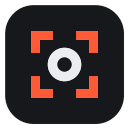
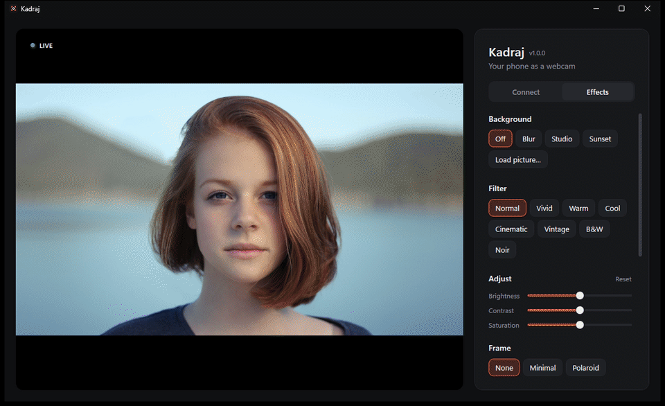
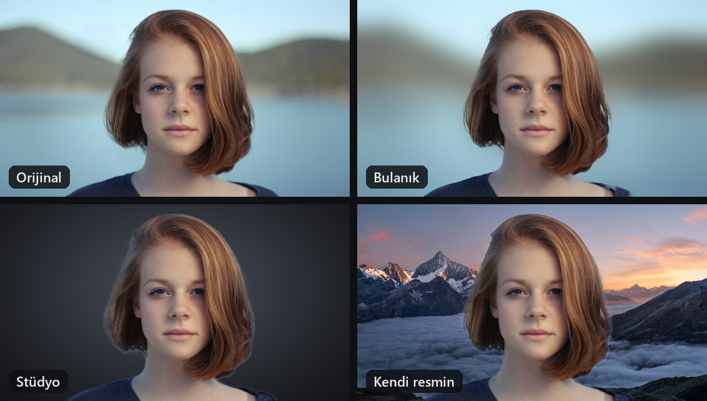
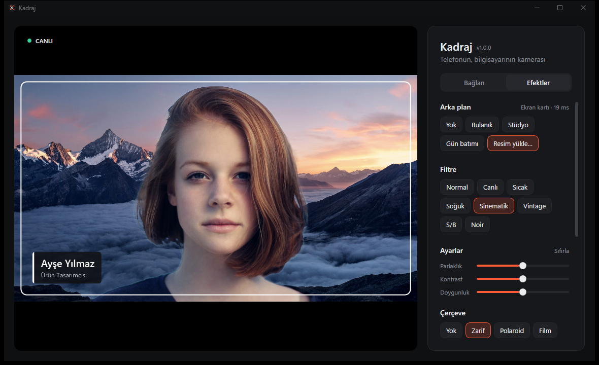
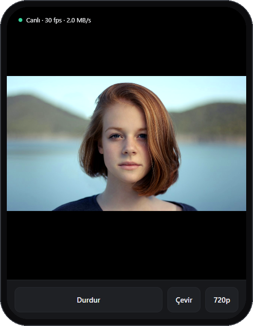
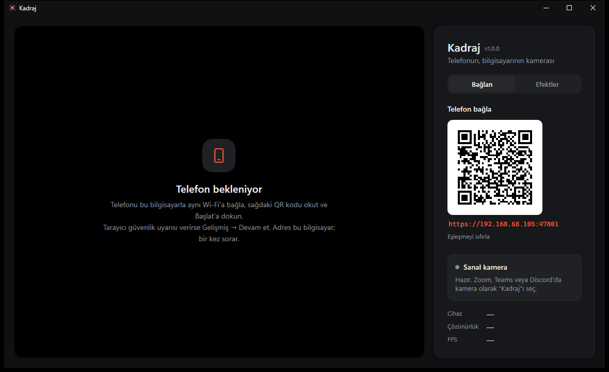
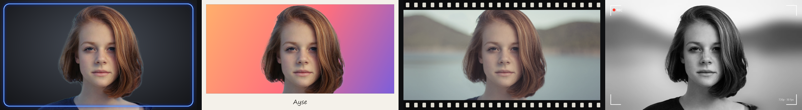
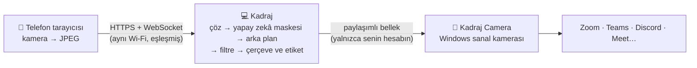

<p align="center">
  
</p>

<h1 align="center">Kadraj</h1>

<p align="center">
  <b>Telefonunu bilgisayarının kamerası yap: yapay zekâ ile arka plan, filtreler, çerçeveler ve isim etiketi.</b><br>
  Telefona uygulama kurmak yok. QR kodu okut, Zoom, Teams, Discord ya da Meet'te yayındasın.
</p>

<p align="center">
  <a href="https://github.com/Cafu1107/kadraj/releases/latest/download/Kadraj-win-x64.zip"></a>
  &nbsp;
  <a href="https://cafu1107.github.io/kadraj/"></a>
</p>

<p align="center">
  <a href="https://github.com/Cafu1107/kadraj/actions/workflows/ci.yml"></a>
  <a href="https://github.com/Cafu1107/kadraj/releases/latest"></a>
  <a href="LICENSE"></a>
  
  
</p>

<p align="center"><a href="README.md">English</a> · <b>Türkçe</b></p>

<p align="center">
  
</p>

## Neden Kadraj?

Telefonunun kamerası dizüstü bilgisayarınkinden çok daha iyi. Kadraj onu bilgisayarının kamerası yapar ve görüntülü görüşmelerde gerçekten işe yarayan eklemeleri getirir:

- **Her uygulamada gerçek bir kamera.** Kadraj; Zoom, Teams, Discord, tarayıcılar ve kamera kullanan diğer uygulamaların kamera listesinde **"Kadraj"** olarak görünür. Efektlerin de onunla birlikte gider.
- **Telefona uygulama yok.** Telefon, tarayıcısında bir sayfa açar. QR kodu okut, **Başlat**'a dokun.
- **Sağlam yapay zekâ arka planı.** Kulaklık, eller ve sallanan kollar görüntüde kalır, kenarlar titremez.

## Özellikler

| 📱 Bağlantı | 🧠 Arka plan | 🎨 Görünüm |
|---|---|---|
| Aynı Wi-Fi, QR kodu okut, bitti | **Bulanık**, **Stüdyo**, **Gün batımı** ya da **kendi resmin** | 8 filtre: Canlı, Sıcak, Soğuk, Sinematik, Vintage, S/B, Noir… |
| Ön / arka kamera, 720p ya da 1080p | Robust Video Matting ekran kartında, kare başına yaklaşık 15 ms | Parlaklık, kontrast ve doygunluk ayarı |
| Flaşı olan telefonlarda ışık düğmesi | Uygun ekran kartı yoksa işlemcide çalışır | **Çerçeveler:** Zarif, Polaroid, Film, Neon, Vizör ya da kendi PNG'n |
| Yayın sırasında telefon ekranı kapanmaz | Saç kenarlarında renk temizleme | **İsim etiketi** (ad + unvan), ayna, doldur/sığdır |

<p align="center">
  
</p>

## Hızlı başlangıç

1. [`Kadraj-win-x64.zip`](https://github.com/Cafu1107/kadraj/releases/latest/download/Kadraj-win-x64.zip) dosyasını **indir**, istediğin yere çıkar ve **`Kadraj.exe`**'yi çalıştır. Başka bir şey kurmana gerek yok.
2. *Sanal kamera* bölümündeki **Kamerayı kur** düğmesine bir kez tıkla. Windows izin ister; bu adım kamerayı sisteme tanıtır.
3. Telefonunu **aynı Wi-Fi**'a bağla, QR kodu okut ve **Başlat**'a dokun. Görüşme uygulamasında kamera olarak **Kadraj**'ı seç.

> İlk seferde telefonun tarayıcısı bağlantı uyarısı gösterir. Bu normal: adres kendi bilgisayarın ve kendi imzaladığı bir sertifika kullanıyor. *Gelişmiş → Devam et* de; yalnızca bir kez sorar.

## Ekran görüntüleri

<table>
  <tr>
    <td width="68%"></td>
    <td></td>
  </tr>
  <tr>
    <td></td>
    <td valign="top"><b>Solda:</b> eşleşme QR kodu ve sanal kamera durumuyla Bağlan sekmesi.<br><br><b>Üstte:</b> telefon sayfası. Ekranı açık tutar ve anlık FPS'i gösterir.</td>
  </tr>
</table>

<p align="center">
  
</p>

## Nasıl çalışır?



- **Telefon → bilgisayar:** Kadraj'ın içindeki küçük bir web sunucusu telefon sayfasını HTTPS ile sunar. Kareler WebSocket üzerinden gelir, ve yalnızca QR koddaki eşleşme anahtarıyla.
- **Efektler:** Her kare, görüşme uygulamasının istediği boyutta oluşturulur. Önizlemede gördüğün, karşı tarafın gördüğüyle birebir aynıdır.
- **Kamera:** Windows Kamera Frame Server'ın yüklediği bir Media Foundation sanal kamerası (Windows 11). Kadraj açıkken görünür, kapatınca kaybolur.

## Gizlilik ve güvenlik

- **Hiçbir şey ağından dışarı çıkmaz.** Hesap yok, bulut yok. Kadraj telemetri göndermez, ONNX Runtime'ınkini de kapatır. Tek indirme arka plan modelidir (~15 MB, bir kez, bütünlüğü doğrulanır).
- **Yalnızca yerel ağ, yalnızca eşleşmiş telefonlar.** Özel adres aralıkları dışından gelen bağlantılar reddedilir. Telefonun bağlanabilmesi için QR koddaki 128 bitlik anahtar gerekir. **Eşleşmeyi sıfırla** yeni bir anahtar oluşturur.
- **Görüntün sende kalır.** Kamera görüntüsü, yalnızca senin Windows hesabının, SYSTEM'in ve kamera servisinin açabildiği bir bellekten geçer.
- Eşleşme anahtarı ve sertifika, Windows hesabına özel şifrelenerek saklanır (DPAPI). Telefon sayfası sıkı bir İçerik Güvenliği Politikası (CSP) altında çalışır.

Bir sorun mu buldun? [SECURITY.md](SECURITY.md) dosyasına bak.

## Sık sorulan sorular

<details>
<summary><b>Windows "Bilgisayarınız korundu" diyor (SmartScreen)</b></summary>

Kadraj henüz kod imzalı değil, bu yüzden SmartScreen onu tanımıyor. **Ek bilgi → Yine de çalıştır**'a tıkla. İndirdiğin dosyayı sürüm sayfasındaki `.sha256` dosyasıyla doğrulayabilirsin.
</details>

<details>
<summary><b>Telefon bağlanamıyor</b></summary>

- İki cihaz da **aynı Wi-Fi**'da olmalı (misafir ağları genelde cihazların birbirini görmesini engeller).
- Windows Güvenlik Duvarı Kadraj için izin sorduysa **izin verilmiş** olmalı.
- Birden fazla ağ bağdaştırıcın mı var (VPN, sanal makine)? Kadraj QR kodun altında başka adresler gösterir; onları dene.
</details>

<details>
<summary><b>Görüşme uygulamasının kamera listesinde "Kadraj" yok</b></summary>

Sanal kamera **Windows 11** gerektirir. Kadraj'da **Kamerayı kur**'a (bir kez) tıkla, Kadraj'ı açık tut, sonra görüşme uygulamasını yeniden başlat ki kameraları tekrar arasın.
</details>

<details>
<summary><b>Telefonu kilitleyince görüntü donuyor</b></summary>

Telefon tarayıcıları, sayfa görünmediğinde kamerayı durdurur. Kadraj yayın sırasında ekranı açık tutar; sayfayı açık bırakman yeterli.
</details>

<details>
<summary><b>Arka plan kaldırma yavaş</b></summary>

*Arka plan* yazısının yanındaki durum, modelin nerede çalıştığını ve bir karenin ne kadar sürdüğünü gösterir. Ekran kartında (DirectX 12) yaklaşık 15 ms'dir; işlemcide daha küçük bir boyut kullanılır. Ekran kartı sürücüsü sorun çıkarırsa `KADRAJ_SEGMENTER=cpu` ortam değişkenini ayarla.
</details>

<details>
<summary><b>Nasıl kaldırırım?</b></summary>

Kamerayı kaldırmak için `Kadraj.exe --uninstall-camera` komutunu yönetici olarak çalıştır. Ardından Kadraj klasörünü ve `%LocalAppData%\Kadraj` klasörünü (ayarlar, eşleşme anahtarı, model) sil.
</details>

<details>
<summary><b>Türkçe Windows'ta uygulamayı İngilizce kullanabilir miyim (ya da tersi)?</b></summary>

`KADRAJ_LANG=en` (ya da `tr`) ortam değişkenini ayarla. Telefon sayfası telefonun dilini izler.
</details>

## Yazılımcılar için

<details>
<summary>Derleme, çalıştırma ve proje yapısı</summary>

**Gerekenler:** Windows 11, *C++ ile masaüstü geliştirme* iş yüküyle Visual Studio 2022 (MSVC + Windows 11 SDK), .NET 9 SDK.

```powershell
.\build.ps1            # debug derleme: C++ kamera + uygulama
.\build.ps1 -Publish   # artifacts\ içine kendi kendine yeten sürüm (zip + .sha256)
```

Derledikten sonra `src\Kadraj.App\bin\Debug\net9.0-windows\Kadraj.exe`'yi çalıştır ve *Kamerayı kur*'a tıkla (`KadrajCamera.dll`'i `C:\Program Files\Kadraj`'a kopyalar ve kaydeder).

| Klasör | İçinde ne var |
|---|---|
| `src/Kadraj.App/Server` | Kestrel sunucusu, eşleşme, sertifikalar, telefon sayfası (`wwwroot/index.html`) |
| `src/Kadraj.App/Video` | JPEG çözme ve kare hattı |
| `src/Kadraj.App/Effects` | Birleştirici, RVM ayırıcı, arka planlar, filtreler, çerçeve ve etiket |
| `src/Kadraj.App/Camera` | Sanal kamera kurulumu ve paylaşımlı bellek yazıcısı |
| `src/Kadraj.Camera` | Frame Server'ın yüklediği C++ Media Foundation kaynağı |

Sürümler, `v*` etiketi gönderildiğinde GitHub Actions tarafından derlenir (`.github/workflows/release.yml`).
</details>

## Yol haritası

- Yüzünü kadrajın ortasında tutan otomatik kadraj
- Aynı anda iki telefon (resim içinde resim)
- Düzgün bir kurulum programı ve kod imzası

Fikirler ve hata bildirimleri [Issues](https://github.com/Cafu1107/kadraj/issues) sayfasına. Ayrıntılar için [CONTRIBUTING.md](CONTRIBUTING.md).

## Lisans

Kadraj, [GNU GPL v3.0](LICENSE) lisanslı özgür bir yazılımdır. [Robust Video Matting](https://github.com/PeterL1n/RobustVideoMatting) (GPL-3.0), [ONNX Runtime](https://github.com/microsoft/onnxruntime), DirectML ve [QRCoder](https://github.com/codebude/QRCoder) kullanır. Ayrıntılar [THIRD-PARTY-NOTICES.md](THIRD-PARTY-NOTICES.md) dosyasında. Tanıtım fotoğrafları [Unsplash](https://unsplash.com)'ten.
